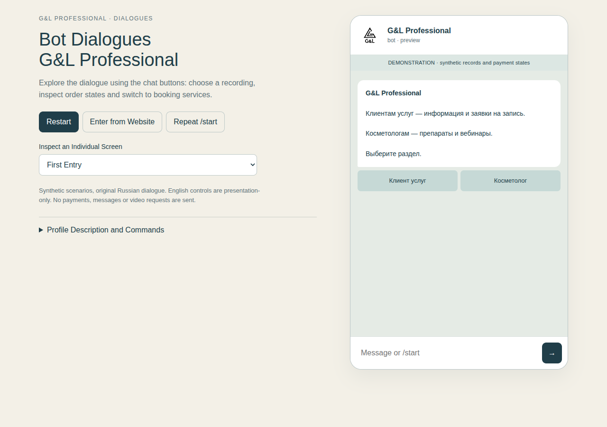

# G&L Professional — Website, Bot and Backend

A connected product experience for a professional cosmetics business: an Astro/Vue website, a Telegram bot for two audiences, and a FastAPI/PostgreSQL backend for bookings, orders and recording access.

**My role:** I developed the product experience and software, from interface design and dialogue flows to backend implementation and verification. [Visit the live website](https://glprofessional.ru/) · [Explore the interactive bot walkthrough](https://timsmykov.github.io/gl-professional-showcase/) · [Read the case study](docs/case-study.md).



G&L retains ownership of its brand and business content. The published walkthrough uses synthetic records and provider responses.

## Explore the case

- [Original business website](https://glprofessional.ru/)
- [Interactive dialogue walkthrough](https://timsmykov.github.io/gl-professional-showcase/)
- [Architecture and decisions](docs/case-study.md)
- [Verification and boundaries](docs/verification.md)

The application retains its original Russian dialogue and content. Case documentation and walkthrough controls are English. The walkthrough uses real BotFlow with synthetic repositories/provider responses: it sends no Telegram messages, payments or video requests.

## Selected original source

```text
site/       Original Astro/Vue website source and selected non-clinical media
backend/    Original bot, FastAPI application, adapters and migrations
scripts/    Independent verification and walkthrough packaging
demo/      Generated scenario walkthrough; no live backend connection
```

`backend-snapshot.json` and `site-snapshot.json` bind the selected files to their original bytes. Run `python3 scripts/verify_snapshots.py` to check them. These are independent, manually selected snapshots: internal development does not update this repository and this repository cannot deploy to the original systems.

The backend includes booking requests, order/payment state handling, recording access, fiscal-receipt handling and provider adapters. Code inclusion and synthetic checks do not establish a complete current buyer purchase-to-playback deployment.

## Reproduce the walkthrough and application checks

Python 3.12+, uv and optionally Docker:

```sh
cd backend
uv sync --locked --extra test
uv run python ../scripts/check_application.py
uv run python ../scripts/build_bot_demo.py
```

From the repository root, `python3 -m http.server 8080 --bind 127.0.0.1` serves the generated walkthrough at `/demo/`.

For database verification, run `uv run python ../scripts/check_database.py` from `backend/`. It uses one disposable local PostgreSQL container, applies the complete migrations twice, runs API/DB checks and removes only its test container. It does not read production configuration.

The site can be checked independently with `cd site`, `npm ci`, `npm test` and `npm run build`. Its original package metadata and lockfile are preserved; known dependency advisories and the tested toolchain are recorded in [verification](docs/verification.md). Clinical media and internal deployment material are deliberately excluded from this snapshot, so use the original business site for the complete visual/product experience rather than assuming all original media is redistributed here.

## Publication boundary

No product logic, text or language was rewritten for this case. Private credentials, customer databases, clinical/patient photographs, native deployment recipes and private execution records are not included. Operational tests that depend on excluded VM recipes are not part of the portable application runner. See [NOTICE](NOTICE.md) for ownership and reuse boundaries.
