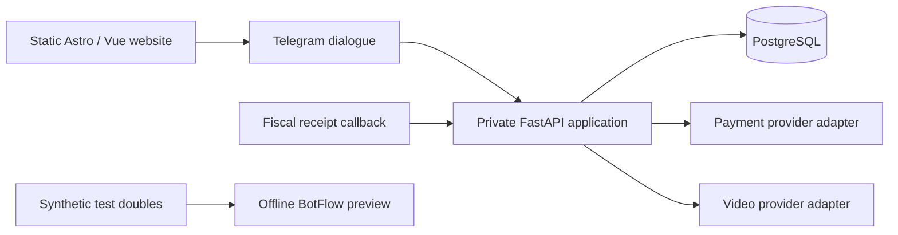

# A connected professional service

## Task and responsibility

Build a coherent website and bot experience while keeping public content, dialogue, operational state and external provider authority separate. Tim Smykov developed the software using AI-assisted development and owned the product/interface and implementation work. The client owns its brand, professional content and business operations.

## Architecture

The published demo replaces provider and repository dependencies with synthetic test doubles. It exercises real dialogue logic without connecting the visitor to Telegram or a payment system.

## Decisions

- Keep the static website free of buyer data and payment authority.
- Give professionals and service clients distinct dialogue paths.
- Treat an appointment request as pending until confirmed.
- Treat a payment redirect or a button click as insufficient evidence of payment.
- Keep order state, fiscal receipts and recording access as separate concerns.
- Use explicit database privileges and additive migrations instead of granting the application schema ownership.
- Make repeated actions, unavailable services and ambiguous payment states visible and testable.

## Evidence and limits

The release publishes selected original source, preserving its content and languages. Its portable application checks, migration/DB checks and walkthrough are revalidated for this exact snapshot; dated results are recorded in verification.md. The business site is linked as the original visual reference.

These checks establish the tested synthetic/application behavior. They do not establish current merchant onboarding, a new real payment, delivery to buyers, production video access or client acceptance of every business scenario. Provider adapters are published as implemented code with those live boundaries retained.
